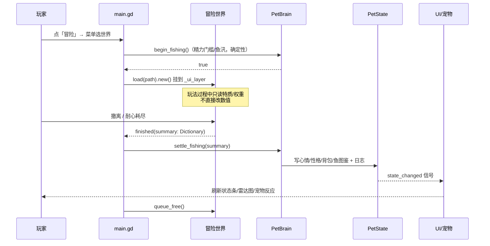

# 毛球 · 类关系图

> 核心架构原则：**场景只产出结果，PetBrain 确定性结算，LLM 只输出台词/情感标签、绝不改数值。**

## 总览（分层与依赖）

```mermaid
graph TD
    subgraph AUTO["Autoload 单例（project.godot）"]
        PS["PetState<br/>PetStateStore · Node<br/>五维/情绪/信任/饱食/精力/口粮<br/>背包/记忆/日志/鱼图鉴 + JSON 存档"]
        PB["PetBrain<br/>PetBrainEngine · Node<br/>确定性规则引擎<br/>apply_interaction / begin_* / settle_*<br/>表情推导 · 特质判定"]
        EV["PetEventDeck · RefCounted<br/>事件权重池 · ITEM_NAMES<br/>LOOT_TABLE · FISH_DEX(8鱼)"]
        SC["Scheduler<br/>EventScheduler · Node<br/>定时衰减 · 口粮恢复<br/>主动搭话 · 随机本地事件"]
        LLM["LLM<br/>LlmClient · Node<br/>DeepSeek/OpenAI 兼容 API<br/>只回台词+情感标签"]
    end

    subgraph MAINLAYER["主场景"]
        MAIN["main.gd · Node2D<br/>组装根：构建 UI/宠物/世界<br/>连接所有信号 · 编排对话流"]
        ACTOR["pet_actor.gd · Node2D<br/>3D 兔子(GLB) SubViewport→2D<br/>读状态播动画/反应"]
        VISUAL["pet_visual.gd<br/>（旧程序化占位，当前未启用）"]
    end

    subgraph UI["UI 控件（main 程序化实例化）"]
        STATUS["status_panel<br/>状态条/口粮/表情"]
        RADAR["radar_chart<br/>五维雷达图"]
        DLG["dialogue_box<br/>台词打字机+输入框"]
        BUBBLE["speech_bubble<br/>头顶气泡"]
        CLOCK["clock_panel<br/>系统时间+天气(HTTP)"]
        BG["cyber_background<br/>纯视觉背景"]
        ADV["adventure_menu · Window<br/>探索/闯关/垂钓 三选一"]
        SET["settings_dialog · Window<br/>API Key 设置/测试"]
    end

    subgraph WORLDS["冒险世界（Control，main 按需 new 挂到 CanvasLayer）"]
        EXP["explore_world<br/>俯视角 Roguelike"]
        PLAT["platformer_world<br/>横版跑酷三关"]
        FISH["fishing_world<br/>数据海垂钓"]
    end

    CFG[("user://llm_config.json<br/>API Key（不进 git）")]
    SAVE[("user://pet_state.json<br/>真实存档")]

    %% --- 核心层依赖 ---
    PB -->|"读写状态"| PS
    PB -->|"读权重/名称表"| EV
    SC -->|"衰减/恢复/写事件"| PS
    SC -->|"调规则"| PB
    SC -->|"取本地罐头事件"| EV
    LLM -->|"组装上下文(只读)"| PS
    LLM -->|"读性格/特质(只读)"| PB

    %% --- main 编排 ---
    MAIN --> PS
    MAIN --> PB
    MAIN --> SC
    MAIN --> LLM
    MAIN --> EV
    MAIN --> ACTOR
    MAIN --> STATUS & RADAR & DLG & BUBBLE & CLOCK & BG & ADV & SET
    ACTOR -.->|"读状态/表情"| PS
    ACTOR -.->|"读反应规则"| PB

    %% --- UI 读状态 ---
    STATUS -.-> PS
    STATUS -.-> PB
    RADAR -.-> PS
    DLG -.-> PS
    SET -->|"加载/测试/保存配置"| LLM
    CFG -.-> SET
    LLM -.-> CFG

    %% --- 冒险：选择 → 开局 → 世界产出 → 结算 ---
    ADV -->|"explore/platformer/fishing_chosen"| MAIN
    MAIN -->|"begin_exploration/adventure/fishing 门槛检查"| PB
    MAIN -->|"实例化"| EXP
    MAIN -->|"实例化"| PLAT
    MAIN -->|"实例化"| FISH
    EXP -.->|"读特质/图鉴"| PB
    PLAT -.->|"读特质"| PB
    FISH -.->|"读特质/鱼汛/图鉴"| PB
    EXP -.-> EV
    PLAT -.-> EV
    FISH -.-> EV
    EXP -.->|"查新鱼/背包(只读)"| PS
    FISH -.-> PS
    EXP & PLAT & FISH -->|"finished(summary: Dictionary)"| MAIN
    MAIN -->|"settle_expedition / settle_platformer / settle_fishing"| PB

    PS <--> SAVE

    classDef auto fill:#123a3f,stroke:#05d9e8,color:#dff;
    classDef world fill:#2a1730,stroke:#ff2a6d,color:#fde;
    classDef ui fill:#1c2430,stroke:#7fd0ff,color:#def;
    classDef old fill:#222,stroke:#666,color:#999,stroke-dasharray: 4 3;
    class PS,PB,EV,SC,LLM auto;
    class EXP,PLAT,FISH world;
    class STATUS,RADAR,DLG,BUBBLE,CLOCK,BG,ADV,SET ui;
    class VISUAL old;
```

## 关键信号流

- **PetState**：唯一的数据归属与存档出口；`state_changed / memory_added / log_added`。
- **PetBrain**：唯一的数值裁决者；信号 `interaction_applied / chat_sentiment_applied`。
- **Scheduler**：信号 `proactive_chat / local_event / needs_attention / special_event`，全部由 main 接收后走罐头播报。
- **LLM**：异步信号 `reply_ready(speech, degraded, reason, sentiment)`；情感标签回传后仍由 PetBrain 决定数值（`chat_sentiment_applied`）。
- **三个世界**：统一契约 `signal finished(summary: Dictionary)` + `_done` 守卫；main 侧统一「开局 begin_* → 世界 → settle_* → queue_free」。
